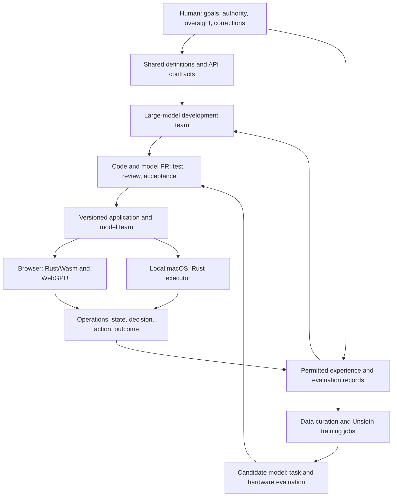
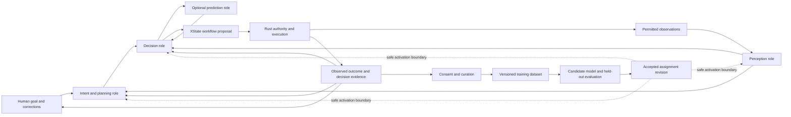

# Eylema Architecture v0.5 — English canonical

**Architecture revision:** 0.5.0 · **Date:** 13 October 2026 · **Language:** English (canonical)

**Product:** Eylema. **Descriptor:** A Simple, High-Performance Agentic AI Web Platform for Continuous Development and Operations.

**Status:** Product architecture with a growing implemented task core. The [core evidence](https://github.com/eylema-dev/eylema/blob/main/README.md) scopes current execution; model, training and complete-product acceptance remain separate.

**Turkish companion:** [Full Turkish architecture](https://github.com/eylema-dev/eylema-docs-tr/blob/main/docs/architecture.md). **Translation revision:** 0.5.0. The original English v0.3 edition was translated from the Turkish source. This English edition establishes the canonical language policy; repository tooling now checks translation byte fingerprints and API identifier parity; semantic equivalence still requires review.

## Language policy

Code, comments, file names, API names, schemas, protocols and contribution records use English. Documentation is bilingual, with English as its canonical source. Turkish is the second language and must remain a complete, synchronized companion. Machine identifiers, enum values, schema keys, and protocol versions remain identical across languages. Translations record their source revision; repository fingerprint checks flag unrecorded translation edits. A language label does not establish semantic equivalence without review.

## Accepted first-product decisions

The 12 October 2026 [decision record and hardware inventory](project-structure.md) select a developer-first, single-user local task console, an early need-to-PR proof and Apache-2.0 for first-party source/docs. The primary M4 Pro target is retained; Mac mini M4 and Linux RTX 4070 Ti Super are additional equipment awaiting separate acceptance. Existing Rust domain types, EYL/EYLJ formats and platform bindings are retained. Optional model and learning work follows deterministic/device measurement.

## Central idea

**Eylema is the platform for defining, running and evolving cooperative agentic loops.** The maintainer clarified this product purpose on 13 October 2026: compose the loop, replace its models and collect permitted data for training. MiniCPM, Qwen and local open-weight decision models are interchangeable participants; the platform owns the stable roles, contracts and lifecycle. The task console is the first interface into that platform and the existing deterministic core is its execution foundation.

An application declares observations, state, goals, actions, role connections, permissions, resource budgets and acceptance conditions. Local participants exchange typed proposals; authorized execution produces observations that feed back into the next decision. Large models can develop these definitions and implementations through the reviewed development workflow. Human corrections and measured outcomes support later dataset and model revisions.

Simplicity belongs in the application contract and setup; renderer, tensor, and data-engine complexity still exists internally. Ordinary web applications load only necessary modules. 3D, local LLMs, and world models are optional capabilities.

The goal of AI-led development and operations covers coding, testing, review, execution, and improvement by authorized AI teams. Humans define goals, authority, and acceptance policies. Deterministic Rust remains a primary execution path; every frame or request does not require an LLM call.

## Accepted experimental macOS scope

The first release targets one Apple M4 Pro MacBook Pro with 24 GB unified memory. G04 records the original macOS 27.0.1 toolchain/SDK/browser inventory; each new acceptance run must record its actual environment and execution separately. Linux support and a second physical device are deferred. Several workloads measured on this Mac never count as multiple devices. This product-document repository remains documentation; current runtime evidence belongs to core, and selecting additional targets does not establish support.

| Surface | First-release contract |
|---|---|
| Local service and CLI | Owned Rust 1.99.0, aarch64-apple-darwin; deterministic executor, durable journal and loopback web service |
| Model and tensor work | Owned Rust CPU reference and native_gpu through Metal; explicit platform bindings, lifetimes and unsafe boundary inventory |
| Browser view | Portable Rust/Wasm components and WebGPU with WGSL; native server/filesystem packages are excluded from Wasm compilation |
| Training | Separate pinned local Unsloth Studio/MLX recipe on this Mac; export must pass owned Rust acceptance before activation |
| Development | Real Codex and Claude adapters plus GitHub are explicitly online; local operation/training never silently calls a hosted model |

HardwareProfile identifies the one physical device and observed capacity. WorkloadProfile identifies execution target, backend, GPU API and exact workload/environment versions on that device. Assignments and evidence bind both identities through model-set schema 0.2.0; the historical 0.1.0 schema stays unchanged. Duplicate/dangling IDs, actual capacity, source/hash trust and evidence coverage need semantic validation; structural JSON validation cannot prove them.

Browser closure does not terminate the local executor or Metal worker. Reopening attaches to current snapshots/events. The local session must enforce Host/Origin checks, CSRF protection, request size/time limits and scoped authority. Durable state defaults to Eylema's macOS Application Support directory; acknowledgement follows durable journal writes. Credentials, private raw training records and hidden model reasoning are excluded from ordinary event records. Platform randomness and hashes use standard macOS services, not new cryptography. macOS, SDKs, browser, drivers, host bindings, Metal shaders and WGSL remain explicit dependencies.

## Topology



Browser and native nodes execute different work through shared contracts. Task identity, ownership, and redelivery rules govern deduplication; external effects do not receive a universal exactly-once guarantee. Their connection has explicit identity, permission, and data-transfer boundaries. A shared protocol provides neither shared memory nor unrestricted device access.

## Small core, optional capabilities

| Area | Responsibility |
|---|---|
| Definitions and tools | Typed application graph; common source for CLI, API, AI tools, and documentation |
| Web and data | HTML/DOM, events, server operations, identity/authorization, persistence, query contracts |
| Agent execution | State, tasks, queues, deadlines, authority, actions, outcomes |
| Compute and 3D | CPU references, GPU jobs, tensors, scenes, resources |
| Model operations | Language, perception, decision, world models; hardware-based assignment of accepted teams |
| Development and learning | Large-model team, PR workflow, curation, training, release evaluation |

These are logical boundaries, not mandatory services. UI, server, data, and compute engines are planned as our own Rust implementation. Leptos, SQLx, wgpu, and Burn are not default production-engine dependencies.

The initial production core targets zero third-party Cargo packages. The Rust toolchain, browser, OS, GPU driver, and model weights remain explicit platform dependencies. **Unsloth is the selected external dependency of the training/packaging environment**, whose Python and accelerator libraries require a separate inventory and pinned versions. The complete development/training chain is therefore not Rust-only.

## Model team

| Capability | Operational role | Output |
|---|---|---|
| Language model | Interpret requests, explain, analyze extended context | Structured task or proposal |
| Perception model | Interpret images, audio, other observations | Observation and estimated state |
| World model | Predict possible consequences of actions | Future state/representation, cost, termination, calibrated uncertainty where available |
| Decision model | Select or score actions against goals/constraints | Policy output, value, candidate ranking |
| Planner | Search or optimize action sequences | Bounded-horizon plan |
| Rust executor | Execute authorized actions; record observations | Actual execution result |

One model may serve multiple roles. Decisions may combine learned policies, value networks, deterministic rules, and search. World models are enabled where their benefit can be measured, rather than required for every decision.

```text
Observation → State estimate → Candidate futures in world model
                   ↓                         ↓
Goals/constraints → Decision model and planner → Action proposal
                                                    ↓
                                     Authority and state validation
                                                    ↓
                                        Actual action → Observation
```

Keep **observed/authoritative application state**, **estimated state**, and **imagined futures** distinct. Predictions do not automatically become persistent facts. Revalidate actions based on an outdated state revision.

Model contracts specify observation/action schemas, normalization, time steps, coordinates/units, validity periods, recurrent-state ownership, reset rules, and prediction horizons. Reevaluate policies when their world model changes; old latent state is not presumed compatible.

[DreamerV3](https://github.com/danijar/dreamerv3) illustrates policy learning through imagined trajectories; [MuZero](https://deepmind.google/blog/muzero-mastering-go-chess-shogi-and-atari-without-rules/) combines learned dynamics with reward, value, and policy predictions for planning. [NVIDIA Cosmos](https://github.com/NVIDIA/cosmos/blob/main/README.md) includes world reasoning, generation, and action-conditioned model/policy examples. These establish neither support in our engine nor general physical correctness. Visually convincing predictions still require our action contracts and closed-loop task evaluation.

## Cooperative agentic loop and stable platform contracts

This revision defines the platform design requested on 13 October 2026. The integration below is proposed, not installed or accepted runtime behavior. Existing task, model and Goal evidence keeps its original scope. In particular, this design neither repairs a provider adapter nor establishes G40 acceptance.

### Compose a loop, then assign models

Eylema provides a versioned loop definition, role-contract registry, model/adapter catalog, execution console, evidence store and dataset builder. A developer connects roles, declares action/observation schemas and budgets, chooses compatible local models, then runs and inspects an accepted configuration. The same loop can later use different weights or model families without rewriting its application logic.

Three approaches were considered: one multimodal model handling every role; an unrestricted conversation among agents; and a typed cooperative loop. The proposed loop keeps specialist roles independently replaceable, bounds execution and supports comparisons against deterministic baselines. Shared model instances may fill several roles when accepted measurements justify this; role boundaries do not require a process or a permanently loaded model per role.

| Role | Initial candidate or mechanism | Contribution to the loop |
|---|---|---|
| Perception | MiniCPM-V; optionally a separately evaluated MiniCPM-o profile | Turn permitted images/video/audio into source-linked observations and uncertain state estimates |
| Intent and planning | Qwen family; retain the pinned Qwen3-0.6B baseline for existing work | Interpret EN/TR goals, propose bounded plans and request missing evidence |
| Decision | Local open-weight policy, value/ranking model, or task-trained Decision Transformer | Score admissible actions against the goal, current evidence and constraints; abstain outside the accepted domain |
| Prediction | Optional task-specific dynamics/world model | Estimate consequences of candidate actions; keep predictions separate from observations |
| Workflow | Proposed local XState coordinator | Schedule role work, waits, deadlines, retries and reconciliation through a versioned statechart |
| Execution and authority | First-party Rust core and EYL/EYLJ | Validate current state, capabilities, approvals and budgets; execute and persist actual results |
| Explanation and evaluation | Structured decision evidence plus task-specific evaluators | Show why an action was proposed, why it was permitted or rejected, and what actually happened |

The maintainer clarified “Jev” as locally running open-weight decision models. It is not a selected product, package or checkpoint. Decision Transformer is an example of an offline sequence-based policy trained on task trajectories; a published architecture or a checkpoint for another environment is not a general decision engine for Eylema. A small task-trained policy/ranker and deterministic search are comparison baselines. MiniCPM and Qwen candidates likewise require exact artifact, tokenizer/preprocessor, operator, rights and backend profiles before execution. The upstream families establish candidate capabilities, not our compatibility or Turkish task quality. [MiniCPM](https://github.com/OpenBMB/MiniCPM-V), [Qwen3](https://qwenlm.github.io/blog/qwen3/), [Decision Transformer paper](https://arxiv.org/abs/2106.01345), [official implementation](https://github.com/kzl/decision-transformer).



The strength of the combination comes from feedback: perception grounds planning; the policy compares concrete options; execution tests the selected option against reality; the next planning/decision step uses the observed discrepancy and corrections. Disagreement or insufficient evidence requests a new observation, bounded replanning or human input. Agreement between models is not independent proof. A workflow iteration has finite step, inference, observation, time and resource budgets; reaching a limit enters a recorded stop condition instead of another unbounded cycle.

There are two timescales. The operating loop uses a fixed accepted assignment and never trains or silently changes models mid-action. The improvement loop curates episodes, trains a candidate, evaluates it and proposes a new release. Training and activation need their own permitted inputs, resources and acceptance. The optional world-model loop also has a bounded horizon and cannot write imagined outcomes as facts.

### Stable contracts, replaceable implementations

| Stable platform element | Contract to preserve when models change |
|---|---|
| Loop definition | Role graph, statechart revision, permitted actions, termination conditions and budgets |
| Role interface | Typed inputs/outputs, units, action space, preprocessing, time semantics, validity, uncertainty and reset rules |
| Authority | A proposal cannot grant permissions; execution rechecks identity, state revision, policy and any required approval |
| Durable identity | Task, episode, step, proposal and execution identities; ordered event cursor and result reconciliation |
| Evidence | Source references, actual model/backend revisions, constraints, candidate scores, outcome and explanation status |
| Dataset lineage | Collection consent, purpose, transformations, labeling/correction history, split membership and retention |

Models, weights, prompts, quantization and inference backends are replaceable only through adapters that pass those contracts. Protocol versions evolve explicitly: incompatible changes require a new contract version, migration and affected-loop reacceptance. Identical JSON shape is insufficient when action meaning, units, calibration or preprocessing changes. This revision proposes contract concepts; it does not add API endpoints, Rust types, schema enums or migrations to the current protocol.

The proposed messages are `ObservationEnvelope`, `PlanProposal`, `DecisionProposal`, `ExecutionReceipt` and `DecisionEvidence`. They bind task/episode/step identities, source/state revision, contract/model/adapter revisions, creation/expiry and budget context as applicable. Perception estimates retain source provenance; proposals name only declared actions; receipts report observed execution status. Secrets and private model reasoning are not message fields. Rust owns their future semantic validation and canonical encoding.

A model change follows candidate registration → contract/reference checks → held-out task comparison → shadow evaluation without effects → bounded canary → accepted assignment → activation between steps. The model registry records immutable hashes, provenance/rights, supported roles/operators, preprocessing, backend and hardware evidence. In-flight steps keep their assignment. Stateful/recurrent/KV data resets on a swap unless an explicit, tested transfer contract exists. Restart and rollback reconcile journaled effects; switching back to old weights does not undo an action. A release that cannot fit during transition must unload at the declared safe boundary rather than assume both versions fit together.

### XState and Rust have different responsibilities

The proposed XState integration is a local, headless workflow coordinator outside the first-party Rust core. It consumes authorized snapshots/events and submits bounded work requests through the common API; the browser projects the same workflow and may close without ending native work. XState guards improve workflow behavior, while Rust independently enforces authority and the authoritative task state. The coordinator may not execute arbitrary tools, modify the journal or treat an actor snapshot as an execution receipt. Its process/IPC restrictions require tests, not trust in this diagram.

Illustrative coordinator phases are `observe → plan → decide → validate → await_approval` when required, then `execute → reconcile → explain → observe`. They are workflow phases, not replacements for current core task states. Invalid/stale input returns to bounded observation or planning; missing capabilities enter an explicit unavailable outcome; exhausted budgets stop the loop. An uncertain external effect enters reconciliation and cannot be blindly retried. Human stop/revocation goes directly to the Rust control path and remains available if a model, XState or explanation generation fails.

EYL/EYLJ remains the durable source of execution truth. Coordinator snapshots are rebuildable projections bound to the statechart/assignment revision and event cursor. On restart, first reconnect to Rust and reconcile each execution identity before invoking work. Event replay must suppress new effects. XState can restore actors and restart invocations, so snapshot restoration alone does not provide safe effect replay. Stopping an XState actor is not proof that a Rust/GPU job has stopped. [XState actors](https://stately.ai/docs/actors), [persistence behavior](https://stately.ai/docs/persistence).

**Proposed dependency exception:** XState and its pinned JavaScript runtime/TypeScript build toolchain add a visible orchestration dependency outside the Rust execution boundary. Before implementation, accept its exact direct/transitive inventory, licenses, process permissions, packaging and failure tests in devguide. This document does not install it or relax current source/dependency gates. A Rust-only execution path remains usable. External inference engines are not implicitly authorized by the XState exception: MiniCPM/Qwen need an accepted owned-runtime support profile or a separately reviewed, explicit backend exception. Model interchangeability means compatible supported profiles, not arbitrary weights.

### Explainability is an evidence product

Each decision records the goal/constraints, observation references and freshness, selected action, considered alternatives and rejection reasons, model scores with calibration status, applicable rule/approval outcome, and subsequent execution result. Unknown confidence stays unknown. Before action, persist the minimum proposal and validation evidence; after action, link the receipt and observed discrepancy. The console distinguishes a model's suggestion, a policy decision and an observed fact, and supports inspecting or correcting each.

A deterministic evidence-based explanation is always available from these fields. Qwen may produce a readable summary constrained to evidence references; an unsupported claim or failed summary falls back to the structured record. Generated rationale and hidden chain-of-thought are not proof of causal reasoning. Suitable feature-based policy/ranking models may use SHAP or counterfactual/ablation analyses with their background data, perturbation method, fidelity and cost recorded. Attribution is not causality, attention is not proof of explanation, and no universal SHAP wrapper is promised for every model. [SHAP](https://shap.readthedocs.io/en/latest/), [causal interpretation limits](https://shap.readthedocs.io/en/latest/example_notebooks/overviews/Be%20careful%20when%20interpreting%20predictive%20models%20in%20search%20of%20causal%20insights.html).

### Training data comes from the whole loop

Collection is an explicit per-loop policy with purpose, permitted fields/modalities, retention, access and export rules. Execution permission alone does not permit training. Store minimal evidence and authorized artifact references; raw audio/video/screenshots are separately opt-in. Exclude credentials, unrelated user content and hidden reasoning. Rights are checked for weights and data independently of Eylema's first-party license.

An episode connects goal, observations, state estimates, available actions, proposed/selected/executed action, timing, actual outcomes, failures, human corrections and all relevant versions. Preserve disagreement, rejection, timeout and aborted episodes instead of training only on successes. The model's preferred action is a proposal; observed outcome and reviewed human correction have distinct provenance. Reward/label definitions are versioned and do not turn every successful command into successful task completion.

The dataset builder derives separate products: perception annotations; language instruction/response examples; policy state/action/reward/next-state trajectories; world-model transitions; and held-out explanation/evaluation records. A derivation records source episode IDs, transformation version, permissions and reviewer/label provenance. Keep related episodes and all their derivatives in the same split to prevent leakage. Collection withdrawal blocks future collection/exports and invalidates affected dataset descendants for future training; already trained weights require an explicit retirement/retraining decision, not a promise of automatic unlearning. Follow the existing [learning protocol](learning-and-training.md).

### First integrated scenario and acceptance

Use the bounded placement environment as a reference loop: a user gives an EN/TR placement goal; a permitted scene image or authoritative scene observation supplies evidence; MiniCPM produces an estimate when vision is needed; Qwen proposes a plan; a local policy ranks valid moves; optional dynamics predicts outcomes; Rust validates and executes the chosen move. Compare actual placement/cost with the prediction, explain deviations and iterate within the budget. A correction becomes an eligible, reviewed dataset example. Repeat the same loop with a second compatible policy and compare results without changing application wiring.

| Acceptance area | Required future evidence |
|---|---|
| Cooperative loop | Complete multiple observe–act–measure iterations; observed discrepancies change a later decision; compare full loop, deterministic baseline and role ablations on held-out tasks |
| Model replacement | Swap two compatible local policies at a step boundary; reject incompatible contracts; verify state reset, unchanged action meanings and version attribution |
| Authority and recovery | Reject stale/forged proposals and expired approvals; inject duplicate delivery and coordinator crash before/after receipt; prove reconciliation avoids repeated confirmed effects |
| Stop and failure | Stop remains usable during model/XState failure; distinguish stop request, effective stop and unknown effect; bounded retries and explicit unavailable outcomes |
| Explainability | Evidence links resolve; rejected alternatives and actual result are inspectable; unsupported summaries and uncalibrated scores are labeled; measure explanation fidelity separately |
| Dataset lifecycle | Consent, redaction, corrected labels, lineage, episode-level splits, withdrawal and export restrictions pass positive and negative cases |
| Locality and resources | Run on the primary M4 Pro; record peak unified memory, load/swap time, p95/p99 decision latency, stop latency and scene contention; prove no hosted fallback |

Freeze numerical limits and evaluation sets in each implementation card after baseline measurement and before candidate scoring. These are acceptance requirements, all **not_run** for this integration revision. Roles operate at different frequencies; keep perception/planning on demand, decision work bounded and explanations off the stop path. Account jointly for weights, vision/audio preprocessing, KV/recurrent state, model transition buffers, XState runtime and browser/Metal memory. No simultaneous-residency, latency or model-quality claim follows from a model's parameter count.

## 3D and WebGPU

The initial 3D scope includes interactive scenes, cameras, object selection/transforms, materials, lighting, asset loading, instancing, and culling. Add level of detail and streaming as workloads require. Precision CAD, constraint solvers, full physics, and video-generating world models remain separate capabilities.

A **shared GPU resource manager** budgets rendering, LLM inference, decision models, and world-model rollouts together. Account for weights, KV/recurrent state, intermediate tensors, textures/meshes, and transfer buffers. Compatible work may share resources within one device context under valid usage/layout rules; universal zero-copy is not promised.

Rendering, fast decisions, language generation, and future prediction run at different frequencies. Split divisible computation into short jobs and bound queues/concurrency. Scheduling pending jobs does not imply instant preemption of arbitrary submitted GPU work. If frame budgets are exceeded, adjust inference frequency, rollout horizon, or scene quality only within the accepted profile.

A 60 FPS target allows approximately 16.7 ms per frame; this is arithmetic, not a measured guarantee. Acceptance measures the combined scene and model team: frame-time p95/p99, task quality, decision latency, memory, and loading cost.

[WebGPU](https://www.w3.org/TR/webgpu/) and [WGSL](https://www.w3.org/TR/WGSL/) define browser graphics/compute. Rust/Wasm is not itself a GPU shader. The intended path generates WGSL from a narrow supported compute definition, with low-level shader access where needed; compiling arbitrary Rust to GPU code is outside the initial scope.

[WebLLM](https://webllm.mlc.ai/docs/) demonstrates browser-local inference and worker separation. It does not remove the architecture, tokenizer, attention/KV, quantization, or kernel work required by our engine. Workers do not add GPU capacity. Browser and native backends require separate support profiles; [CubeCL's platform comparison](https://github.com/tracel-ai/cubecl#supported-platforms) illustrates their differing capabilities. Feature/limit queries and actual measurements govern selection.

## Hardware-based teams and releases

Selection follows: workload → supported model/operators/format → quality threshold → resource budget → combined-scene measurement → accepted team.

A running device assigns only options within an accepted `ModelSetRelease`. Model, quantization, engine, or behavioral-contract changes create release candidates. Discovery triggers evaluation, not automatic activation. PRs, evaluations, controlled deployment, and rollback have independent records.

Each model progresses through four support states: specified; validated against reference outputs; executed on a named local runtime; accepted for a particular scene/team/hardware combination. Training support is recorded separately. LLM support does not establish convolution, recurrent-state, or diffusion support. **No model has yet been classified as running in our engine.**

Version the operations protocol, model team, device assignment, behavior contract, training dataset, recipe, and evaluation set separately; events link their revisions. Reassess relevant compatibility evidence after environment changes.

## Continuous learning and ecosystem

Permitted experience records link context, observation, proposed/executed action, actual outcome, cost, and human correction. Raw records undergo cleaning, provenance/permission checks, deduplication, and quality review. Include representative successes alongside failures and corrections. A model's answer is not automatically a correct label.

Language examples, decision trajectories, world-model transitions, and hardware measurements use distinct data contracts. Split training/test data by related sessions, time, and tasks. Collection permission is separate from execution authority; using the platform does not authorize community training on its data.

Pinned Unsloth recipes select supported architectures/methods and use separate training budgets. Exported candidates must pass numerical compatibility and task evaluations in our Rust CPU/GPU paths. Unsloth fine-tuning/RL/export capabilities do not establish compatibility with every custom world model or our engine. [Unsloth](https://github.com/unslothai/unsloth), [export troubleshooting](https://docs.unsloth.ai/basics/saving-and-using-models/troubleshooting)

Community contributions may include permitted datasets, labeling rules, task/evaluation packages, training recipes, model packages, hardware profiles, and Rust kernels. Each carries provenance, usage terms, revision, and reproducible evidence. Private raw data and hidden evaluation sets do not automatically become public packages.

## Shared API for humans and AI

The API is a core deliverable. Shared typed contracts underpin Rust SDK, HTTP, event streams, CLI, and AI tools, with human guidance and machine-readable capability schemas derived from them. Formats such as OpenAPI/JSON Schema do not mandate an external production engine.

| Human relationship | Contract requirement |
|---|---|
| Human-in-the-loop | Policy-designated actions await a decision bound to specific plan/input/state revisions |
| Human-on-the-loop | Humans observe execution and reasoned outcomes, request intervention/stopping, and verify the resulting state |
| Human-in-command | Humans define goals, authority, budgets, delegation, and revocation policy |

These modes may coexist per action. Low-impact steps do not universally require repeated approval. AI operates within valid authority; actions outside it stop explicitly. Cancellation does not automatically reverse external effects already produced.

Each operation documents purpose, inputs/outputs, preconditions, effects, authority, timeout, retries, idempotency, oversight, and errors. Once implemented, examples must compile/run in CI and be tied to releases. Current examples remain proposed contracts.

## Development sequence and first product evidence

| Slice | Deliverable | Acceptance evidence |
|---|---|---|
| 0 | Narrow goal; API/state/action contracts; support/dependency matrix | Consistent interpretation by human and AI tools |
| 1a | Rust task contracts, deterministic executor and local journal | Authorized execution, bounded work, truthful cancellation and restart recovery |
| 1b | Minimal web interface and local host service | Create, run, inspect, stop, save and reopen a task in a browser |
| 1c | Early bounded need-to-PR workflow proof | Real scoped task, checks, separate review and actual PR; autonomous-adapter support requires its own execution |
| 1d | Optional WebGPU 3D scene | Object movement and real browser/device execution |
| 2 | Deterministic decision baseline, own tensor operations, small learned policy/dynamics model | Prediction/observation error, closed-loop success, CPU/GPU parity |
| 3 | One supported small local language model and shared GPU management | LLM, decisions, and scene meet quality/resource limits together |
| 4 | Experience records, human corrections, first Unsloth recipe/model acceptance | Traceable data-to-model improvement on separated evaluation tasks |
| 5 | Large-AI team orchestration, GitHub PR workflow, hardware-based team release | Real requirement-to-PR flow; justified assignment across two workloads on one physical Mac |
| 6 | Production web features and contribution ecosystem | Selected production protocols and independent contribution compatibility |

API and evaluation definitions belong in every slice. The maintainer selected the task core and web flow as the first working application. [Project structure and acceptance scenarios](project-structure.md) describe the proposed implementation. A small 3D warehouse/placement environment follows that proof, with learned decisions and natural-language goals added at later milestones. Current core evidence records the implemented task-console subset; later capabilities still require their own acceptance.

Building our own web engine, renderer, model runtime, and training ecosystem is substantial work. AI teams may accelerate development; hardware validation and maturation remain necessary. Scope expands through executed evidence, without universal model/device compatibility promises.

## Detailed contracts

- [Development and local operations team protocols](development-and-operations.md)
- [Learning data and training protocol](learning-and-training.md)
- [English API reference](api-reference.md)
- [Development request JSON Schema](https://github.com/eylema-dev/eylema/blob/main/ai-team-protocol/request.schema.json)
- [Local model team JSON Schema](https://github.com/eylema-dev/eylema/blob/main/ai-team-protocol/v0.2/model-set-release.schema.json)

These are architecture and structural-contract deliverables. Repository contribution tooling and PR work are separate from the planned autonomous development team. No training, model/device benchmark, framework execution or scheduled monitoring is demonstrated by these documents.
