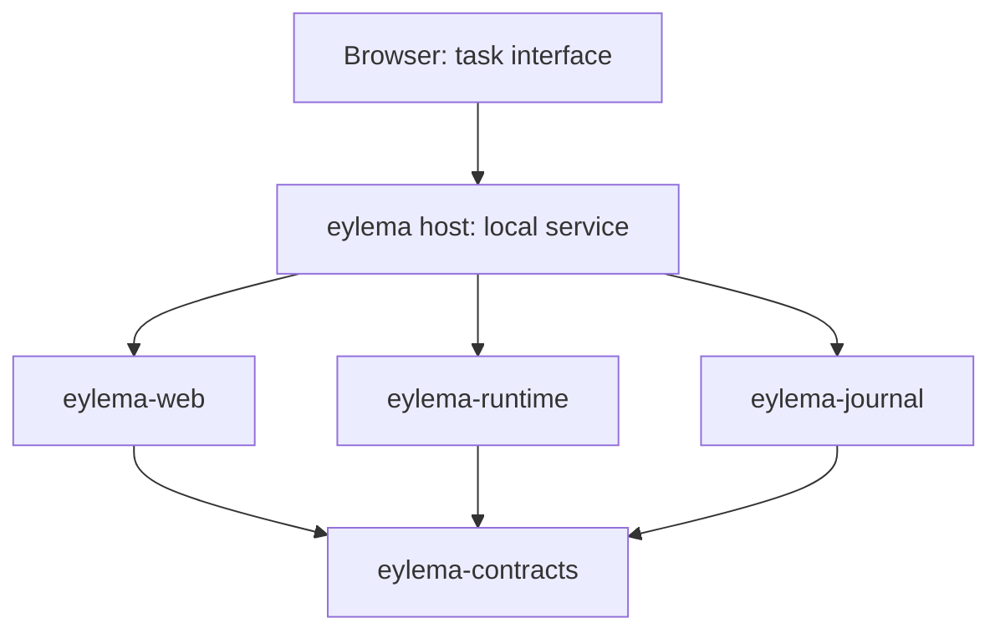

# Project structure and first working application

Revision **0.2.0**, 11 October 2026. [Turkish companion](https://github.com/eylema-dev/eylema-docs-tr/blob/main/docs/project-structure.md).

**Accepted direction:** prove the task core and web interface first: create, run, stop, save and reopen a task. The maintainer selected this flow on 11 October 2026. **Proposed implementation:** the component names, dependency layout and workload below are for architecture review before EYL-003. No Rust workspace or application is implemented by this document.

## One platform, a small first application

Eylema's long-term scope remains a Rust web platform for AI-assisted development and local agent operations. The first application establishes reliable task execution and recovery. The later 3D, GPU, model and learning milestones extend that foundation; they are not prerequisites for the first browser demonstration.

Proposed workload: a bounded sequence of deterministic steps with visible progress and a recorded result. Steps update only the application's own task state. A person can create a task, start it, inspect its events, stop remaining work, restart the local service and reopen the same saved task. This gives the state, authority, cancellation and persistence contracts a concrete test without requiring model access or a GPU.

## Language and repository layout

English is canonical and Turkish is its synchronized companion. Code, identifiers, templates and technical records use English. The [organization repository map](https://github.com/eylema-dev/devguide/blob/main/docs/en/repository-map.md) owns repository boundaries. This repository owns the current English product documents; core Rust components and schemas stay together in `eylema`. Contribution policy lives in `devguide`. The split changes document ownership, not the proposed runtime architecture below.

## Proposed Rust components

Start with one Cargo workspace and one local host process. These are module responsibilities, not a requirement to introduce independently deployed services. Add a crate only when its boundary has executable tests and an actual consumer.

| Planned component | Owns | Allowed direct project dependencies |
|---|---|---|
| `crates/eylema-contracts` | Versioned task, proposal, execution, command, event, permission, budget and error types | None |
| `crates/eylema-runtime` | Deterministic transitions, admission checks, bounded step execution and effective cancellation | `eylema-contracts` |
| `crates/eylema-journal` | Versioned local records, append/replay and explicit recovery failures | `eylema-contracts` |
| `crates/eylema-web` | Minimal HTML interface, bounded request decoding and response/event presentation | `eylema-contracts` |
| `apps/eylema` | Host entry point, local configuration and composition of runtime, journal and web | The four components above |
| `eylema-examples/task-console` | Reproducible task definition, fixtures and browser walkthrough | Public application contracts |

The task-console example is an external consumer in `eylema-examples`, pinned to a core revision; it is not another crate in the core workspace. Core unit/recovery fixtures remain with the implementation they verify.

Dependencies point toward contracts. The runtime does not import browser, GitHub or model-provider integrations. The host coordinates persistence and execution; the web component cannot bypass authority checks or write the journal directly. Wire formats are adapters over the same versioned semantics. Future browser/Wasm execution receives its own supported capability profile; a browser interface connected to macOS does not prove that the runtime runs in Wasm.

Use owned Rust production code and no external production Cargo packages under the current policy. Rust, the browser, operating system and any required host bindings remain explicit dependencies. CI Python stays outside the application runtime. Rust 1.99.0 and aarch64-apple-darwin are selected for the native Mac target, with wasm32-unknown-unknown for explicitly portable libraries. G04 must inventory actual tools/SDKs/browser; G07 must activate real compilation/test gates before Rust source is accepted. Journal format, request encoding and host bindings need their own reviewed implementation.

## Mac host and portable-library boundary

The first experimental device is one Apple M4 Pro MacBook Pro with 24 GB unified memory; macOS 27.0.1 is observed, with tool inventory and actual execution still pending G04. Native service/CLI, durable journal and later CPU/Metal model workers belong to the host. Browser rendering uses Wasm/WebGPU/WGSL on that same device. Compile only reviewed portable libraries to Wasm; the filesystem/server host is native. Neither target selection nor cross-compilation establishes accepted execution.

Later Metal/model/orchestrator modules are added only with tested boundaries and real consumers. Browser closure does not stop the native worker; reopening attaches to saved state/events. Journal state defaults to macOS Application Support/Eylema, with acknowledgement after durable writes and no private raw training material or credentials in ordinary records. Linux and second-device acceptance remain future scope.

## Acceptance for the first browser demonstration

Task identity and execution identity remain separate, following the [API contract](api-reference.md). A task can exist before it is run. A retry or cancellation must identify the execution it affects. Saving is a durability property of accepted changes, not a new API operation invented by the screen design.

| ID | Scenario | Required evidence | Roadmap |
|---|---|---|---|
| F1 | Create a valid task and inspect it | Stable task ID, scope, budget and revision; invalid input rejected | M1–M2 / EYL-004, EYL-006 |
| F2 | Run an authorized deterministic task | Recorded execution, ordered progress and result; denied action has no unauthorized effect | M1–M2 / EYL-004 |
| F3 | Stop an execution while work remains | Receipt and effective stop are distinct; remaining steps stop; completed effects stay visible; late stop preserves a completed result | M1–M2 / EYL-004, EYL-006 |
| F4 | Restart and reopen saved state | Same task/execution IDs, revisions, outcomes and events; in-flight recovery policy exercised | M2 / EYL-005, EYL-006 |
| F5 | Repeat a request or submit a stale revision | Identical replay returns the original reference; changed payload and stale revision fail explicitly | M1–M2 / EYL-004, EYL-005 |
| F6 | Interrupt a write or encounter an incompatible record | Declared recovery or explicit failure; no fabricated completion and no silent data loss | M2 / EYL-005 |
| F7 | Exceed limits or encounter an unavailable capability | Bounded input/queue/work, explicit errors and truthful outcome after deadline expiry | M1–M2 / EYL-003, EYL-004, EYL-006 |

The storage contract must state when a write becomes durable and how journal failure affects acknowledgement. A stop request is not success evidence, and an elapsed deadline is not proof that work stopped. Restarting must not silently re-execute uncertain external effects. The initial workload avoids external effects, but its records must preserve the distinction.

First run the Rust state-machine and recovery tests natively on the M4 Pro Mac, then demonstrate the interface in a named browser against that service. Separately report Wasm compilation and any actual Wasm execution. M1/M2 do not establish WebGPU, model inference, training or autonomous development support.

## Decisions to make before implementation

| Decision | Proposal or known boundary | Required resolution |
|---|---|---|
| First product outcome | Task core and web flow above | Selected by the maintainer; record changes to this goal explicitly |
| Workspace boundaries and workload | Component table and bounded deterministic steps | Review the proposal before EYL-003; directory names are not published packages |
| Toolchain and first devices | One M4 Pro/24 GB physical Mac and separately bound native/browser workload profiles | Verify Rust 1.99.0/targets and observed macOS/SDK/browser inventory in G04; measure workloads on this device, with Linux and second physical device deferred |
| Persistence and recovery | Local append/replay journal with explicit durability semantics | Fix format/version, torn-write detection, replay/idempotency retention and in-flight recovery behavior in EYL-005 |
| Initial network exposure | Propose a loopback-only local prototype | Require local session, Host/Origin, CSRF, request limits and authority checks before EYL-006; remote use needs a separate authentication/TLS design |
| Public distribution terms | License selection is pending | Maintainer decides EYL-001; public source visibility does not settle reuse terms |

The next implementation task is EYL-003 after the component proposal and required environment decisions are accepted. Build the smallest workspace needed by EYL-004, connect real Rust CI and replace the documentation-only source guard in that same change. EYL-005 and EYL-006 complete the first saved-task browser flow. Separate acceptance remains necessary for every later capability.
